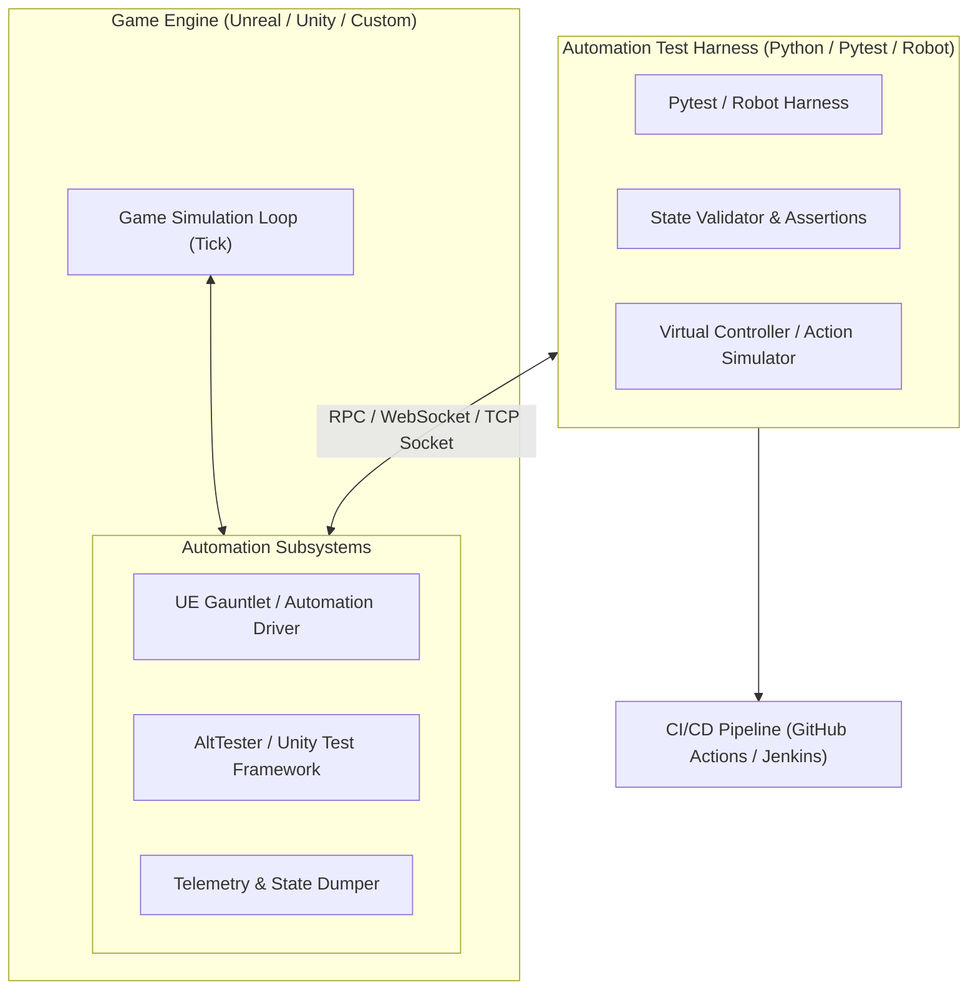
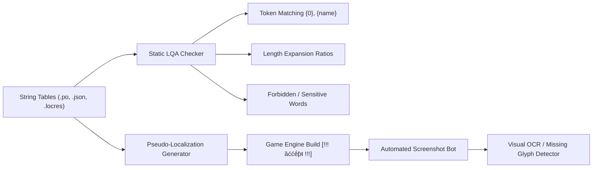

# Game QA Automation: In-Depth Industry Research & Implementation Plan

> **Domain:** Video Game Quality Assurance (Gaming QA)  
> **Subdomains:** **FQA** (Functional Quality Assurance) & **LQA** (Localization Quality Assurance)  
> **Target Audience:** QA Engineers, SDETs, Game Producers, Localization Managers

---

## Executive Summary

Unlike standard web/mobile software where the DOM or native accessibility trees expose UI nodes directly, **video games are real-time simulation engines** (Unreal Engine, Unity, proprietary C++ engines) rendering continuously into an OpenGL/DirectX/Vulkan buffer at 30 to 120 FPS.

Traditional black-box test tools cannot inspect inside an engine canvas without dedicated hooks, RPC bridges, or computer vision. This research document and blueprint detail how modern game studios automate **FQA** (mechanics, physics, game state, regression) and **LQA** (translation integrity, text clipping, pseudo-localization, glyph rendering, cultural compliance).

---

## 1. Deep Research: Functional Game QA (FQA)

### 1.1 The Nature of FQA in Gaming
FQA verifies that all gameplay systems, physics, game states, user interfaces, economy balances, and network multiplayer features function as designed by game designers.

Key challenges in games vs. web apps:
- **Non-deterministic environments:** Physics calculations, ragdoll effects, AI pathfinding (NavMesh), and frame rate jitter introduce variance.
- **Continuous real-time input:** Game loops process ticks/deltas every 16ms (60 FPS); automation must handle continuous gamepad/keyboard/touch inputs.
- **Asynchronous save/load & network replication:** Synchronization across client/server with latency and packet drops.

### 1.2 Industry FQA Automation Architectures



#### Major FQA Approaches:
1. **Engine-Level RPC & Instrument Harnesses (White-Box / Grey-Box):**
   - **Unreal Engine:** Gauntlet Automation Framework, Unreal Automation Driver (`FAutomationDriver`), UTest plugins.
   - **Unity:** AltTester (AltUnity), Unity Test Framework (UTF). AltTester injects a WebSocket server inside the game build, exposing game objects, coordinates, hierarchy, and component properties to external Python/C# scripts.
2. **Deterministic Playback & Command Replay (Grey-Box):**
   - Capturing input frame by frame (reproducible seed, fixed time-step) to replay smoke runs through tutorial levels or stress test performance.
3. **Telemetry & Log Assertion (Grey-Box):**
   - Game logs structured JSON events (e.g. `{"event": "player_spawned", "hp": 100, "coords": [12, 0, 45]}`) enabling fast assertion verification.
4. **Computer Vision & Visual AI (Black-Box):**
   - OpenCV template matching, OCR (Tesseract / EasyOCR), and perceptual hashing for platforms with locked hardware (PlayStation, Xbox, Nintendo Switch dev kits).

---

## 2. Deep Research: Localization Game QA (LQA)

### 2.1 The Nature of LQA in Gaming
LQA ensures that all in-game text, UI elements, audio dialogue, subtitles, and cultural adaptations work correctly across all supported languages (locales: EFIGS, CJK, Arabic, etc.).

LQA goes far beyond simple string translation:
- **Text Truncation & Clipping:** German (`DE`) and French (`FR`) text often expands by 20%–40% compared to English (`EN-US`), overflowing UI buttons, dialog boxes, and HUD badges.
- **Font & Glyph Rendering:** Missing characters (the infamous "tofu" `□` character) when custom game fonts lack Chinese characters, Japanese Kanji, Korean Hangul, or Cyrillic characters.
- **Bi-Directional (BiDi) & RTL Layouts:** Arabic and Hebrew require right-to-left layout, inverted UI arrows, and connected cursive letterforms.
- **String Concatenation & Grammar Variables:** Dynamic tokens like `{item_count} {item_name}` breaking plurals or gender declension in Polish, Russian, or Spanish.
- **Untranslated / Hardcoded Strings (Ghost Strings):** English text showing up in Japanese localization because strings were hardcoded in blueprints or code rather than localization tables (`.po`, `.csv`, `.locres`).

### 2.2 Automation Strategies for LQA



1. **Static Analysis & String Integrity Checks (Pre-Engine):**
   - Compare master language (e.g., `en-US`) keys with all target locale keys.
   - Verify format specifiers (`%s`, `{count}`, `{player_name}`) match across all translations without missing or swapped tokens.
   - Character count threshold checks.
2. **Pseudo-Localization:**
   - Generating synthetic strings with accented characters (`[!!! Ḽǿɠīƞ !!!]`) and 30-50% length padding to visually highlight hardcoded strings and UI truncation before human translators even start.
3. **Automated Screenshot Walkthroughs + Computer Vision:**
   - Automation bots navigate menus and dialog sequences in 15+ languages, saving high-res screenshots.
   - OCR and text bounding-box detectors check if text spills outside button boundaries or contains missing font glyphs (`?`, ``, `□`).

---

## 3. High-Level Automation Architecture & Tooling

```
game_qa_automation/
├── docs/
│   └── game_qa_research_and_plan.md   # Deep architectural analysis and roadmap
├── fqa_functional_qa/
│   ├── engine_state_client.py         # Mock RPC client communicating with game engine loop
│   ├── test_gameplay_mechanics.py     # Functional test scenarios (Health, Inventory, Combat, State)
│   └── mock_game_engine.py            # Simulated game server with tick loop & state inspection
├── lqa_localization_qa/
│   ├── static_string_auditor.py       # Validates key parity, missing tokens, and placeholders
│   ├── pseudo_localizer.py            # Generates pseudo-localized game assets for UI stress testing
│   ├── ui_overflow_detector.py        # Calculates text length expansion against UI container limits
│   └── sample_locales/                # Multi-language translation tables (EN, ES, DE, JA, AR)
└── shared_tools/
    ├── visual_comparator.py           # Perceptual hash & bounding box analysis for game UI
    └── game_test_reporter.py          # Unified visual reporting utility for game test runs
```

---

## 4. Multi-Phase Implementation Plan

### Phase 1: Core Tooling & Static Validators (Immediate)
- Build the **LQA Static String Auditor**: Automated scanning of translation tables across multiple locales checking for key parity, broken interpolation variables (`{player}`, `{xp}`), and length overflow warnings.
- Build the **Pseudo-Localization Engine**: Implements bracket-tagging, glyph substitution (Accents/Diacritics), and text expansion algorithms.
- Build the **FQA Mock Game Engine & RPC Protocol**: A simulated game engine tick server exposing state querying, input simulation, and event hooks (demonstrating how tools like AltTester/Gauntlet work).

### Phase 2: Functional Scenario Testing (FQA)
- Implement test suites in Python (compatible with Pytest & Robot Framework):
  - Character stats verification (health depletion, damage calculation, buff stacking).
  - Inventory slot constraints & item pickup validation.
  - Game state machine validation (Main Menu -> Loading -> In-Game -> Pause -> Game Over).

### Phase 3: Visual & Localization Screen Automation
- Implement UI boundary collision and truncation estimators.
- Computer vision helpers to detect missing font glyphs (`□`) and clipped labels.

### Phase 4: CI/CD Pipeline & Game Studio Workflows
- GitHub Actions workflow running LQA audits on pull requests whenever translation files change.
- Automated headless game test execution producing standardized QA artifacts (logs, test reports).
